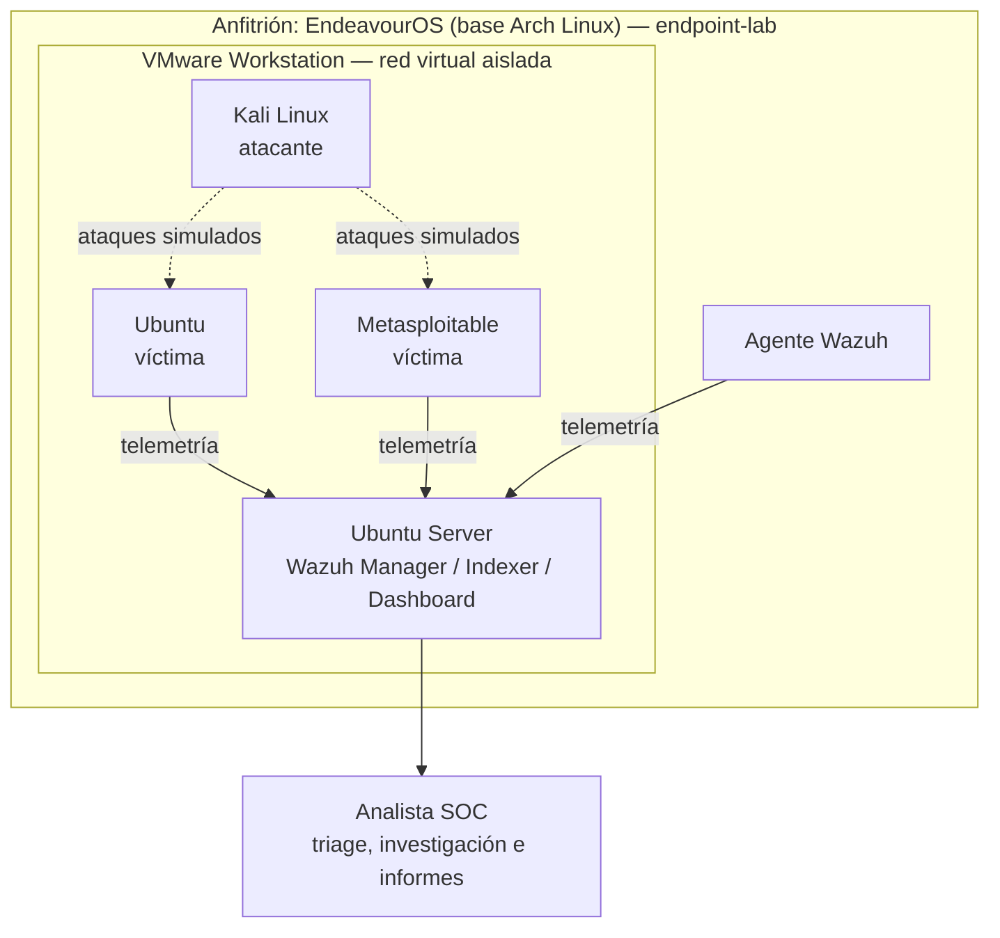

# 🛡️ SOC Home Lab — Wazuh

> Laboratorio de ciberseguridad defensiva construido desde cero para simular las operaciones de un Centro de Operaciones de Seguridad (SOC), con foco práctico en detección, análisis y respuesta a incidentes.

## 🎯 Objetivo

Este repositorio documenta mi recorrido práctico como aspirante a Analista SOC. El objetivo no es solo reunir herramientas, sino demostrar que comprendo el flujo de trabajo completo: desde la ingesta de logs en un SIEM hasta la investigación de una alerta y la redacción de un informe de incidente.

## 🏗️ Arquitectura del laboratorio

El laboratorio corre sobre un equipo anfitrión con EndeavourOS (base Arch Linux). Sobre él, VMware Workstation aloja las máquinas virtuales en una red aislada: un servidor Wazuh como SIEM, una máquina atacante y dos víctimas.



| Rol | Sistema | Host | IP |
|---|---|---|---|
| Anfitrión y endpoint monitoreado | EndeavourOS (Arch Linux) | `endpoint-lab` | 192.168.1.20 |
| SIEM | Ubuntu Server + Wazuh | `siem-server` | 192.168.1.10 |
| Atacante | Kali Linux | — | — |
| Víctimas | Ubuntu, Metasploitable | — | — |

> ℹ️ Las direcciones IP son de ejemplo (rango privado) y no corresponden a mi red real.

## 🧰 Habilidades demostradas

- **Operaciones SOC:** triage de alertas, investigación y análisis de causa raíz.
- **Validación de detecciones:** verificación de que las reglas de Wazuh detectan el comportamiento esperado.
- **Análisis de incidentes:** documentación estructurada de casos (falsos y verdaderos positivos).
- **Frameworks:** mapeo de técnicas a MITRE ATT&CK.
- **Virtualización y Linux:** diseño de un laboratorio con VMs, diagnóstico y administración de sistemas (Arch y Ubuntu).

## 📋 Metodología

Cada informe sigue un estándar fijo: identificación, resumen ejecutivo, línea de tiempo, recolección de evidencia, análisis de hipótesis y mapeo MITRE ATT&CK.

## 📂 Estructura del repositorio

```text
SOC-Home-Lab/
├── casos-de-uso/          # Informes detallados de incidentes investigados
│   ├── capturas/          # Evidencia visual (capturas sanitizadas)
│   └── INC-*.md           # Informes individuales
└── README.md              # Este archivo
```

## 🔍 Casos de estudio

- [**INC-20260925-001**](casos-de-uso/INC-20260925-001.md): Falso positivo en Rootcheck de Wazuh. Análisis de una alerta de "binario troyanizado" y verificación de integridad con `pacman`.
- [**INC-20260929-001**](casos-de-uso/INC-20260929-001.md): Detección de creación de cuenta (T1136). Validación de la detección de persistencia mediante la creación de un usuario local.
- [**INC-20261002-001**](casos-de-uso/INC-20261002-001.md): Caída y recuperación del Wazuh Manager. Diagnóstico y resolución de un fallo crítico del SIEM por un formato de lista incorrecto y un timeout de systemd.

## 🛠️ Herramientas y tecnologías

| Categoría | Herramienta |
|---|---|
| SIEM | Wazuh (Manager, Indexer, Dashboard) |
| Virtualización | VMware Workstation |
| Sistemas | EndeavourOS (Arch Linux), Ubuntu Server, Ubuntu |
| Ofensivo (simulación) | Kali Linux, Metasploitable |
| Threat intelligence | VirusTotal |
| Gestión de paquetes | Pacman |
| Diagnóstico | `journalctl`, `systemctl` |
| Framework | MITRE ATT&CK |

## 🚀 Próximos pasos

- [ ] Implementar reglas de detección personalizadas en Wazuh.
- [ ] Simular ataques desde Kali y mapearlos a MITRE ATT&CK.
- [ ] Añadir un endpoint Windows con Sysmon para ampliar la telemetría.
- [ ] Documentar el análisis de IOC con OSINT (flujo SOC nivel 1 y 2: AbuseIPDB, VirusTotal, Cisco Talos, BGP HE, AlienVault OTX, MXToolbox, Shodan y Security Headers).
- [ ] Automatizar la recolección de evidencia con scripts.
- [ ] Explorar la integración con más herramientas de threat intelligence.

## 📫 Contacto

- LinkedIn: [Franco Aravena](https://www.linkedin.com/in/franco-aravena-323186368)

---

*Este repositorio forma parte de mi portafolio personal de ciberseguridad.*
